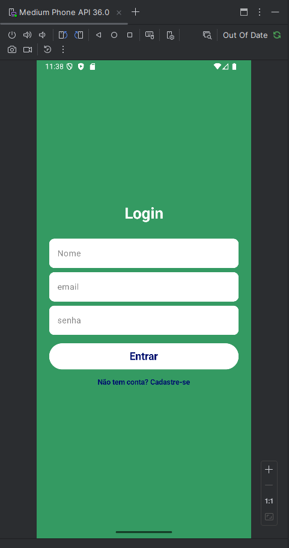
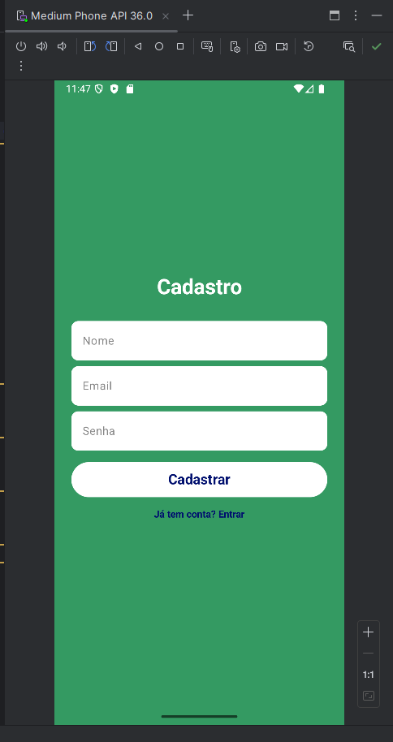
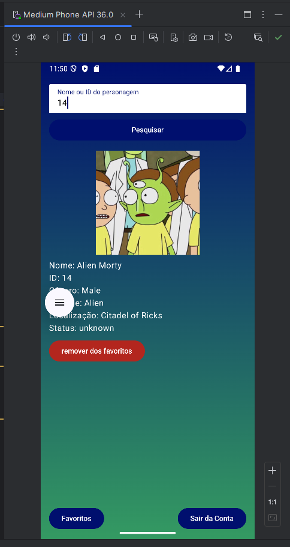
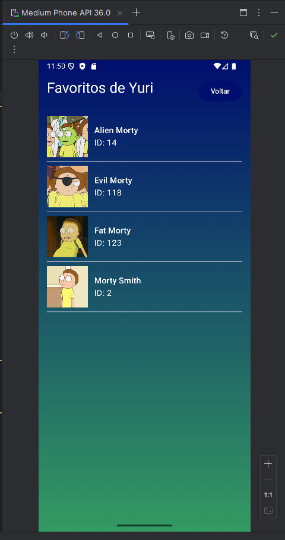
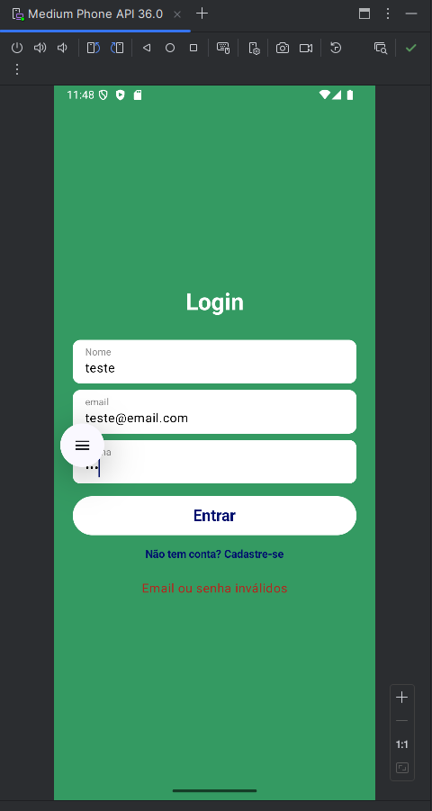
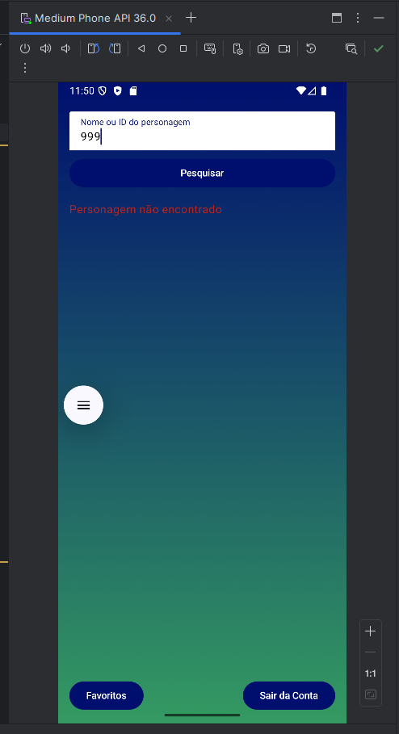

**⚠ ESTE REPOSITÓRIO É UM FORK DO PROJETO DE [ORACKA](https://github.com/Oracka/ProjetoApi_kotlin) (YURI, INTEGRANTE DA EQUIPE). TODOS OS CRÉDITOS VÃO PARA ELE ⚠**

# Projeto Kotlin - API Personagens 
Trabalho em equipe no desenvolvimento kotlin, trabalhando com api aberta.  
**Obs:** Versão de lab utilizada para desenvolvimento.

## API: Rick and Morty API
Consulta à [API](rickandmortyapi.com/api) que retorna personagens por meio de busca por ID ou por nome, com funcionalidade de favoritar. 

## Divisão de tarefas
| Integrante | O que fez |
|------------|-----------|
| Yuri | Programação do projeto |
| Leonardo Silva | Design das telas |

## Prints do projeto funcional: 
### Tela de login:  
  

### Tela de cadastro:  
  

### Tela de busca:  
  

### Tela de favoritos:  
  

### Telas de erros:  

